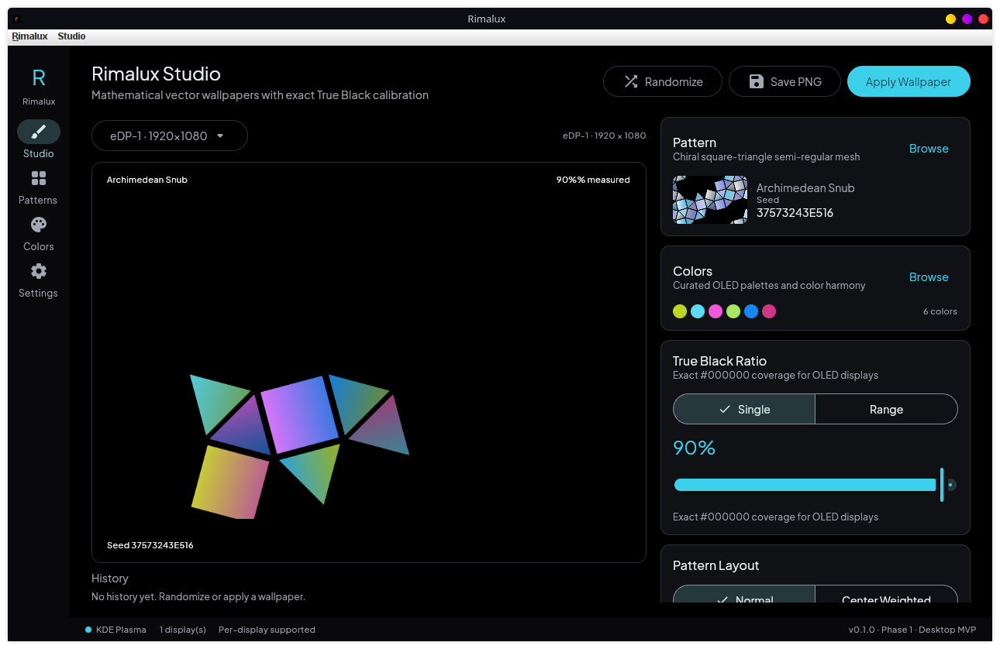
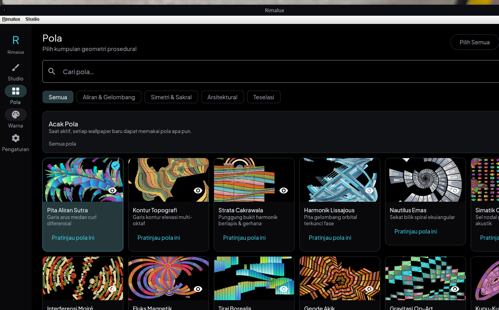
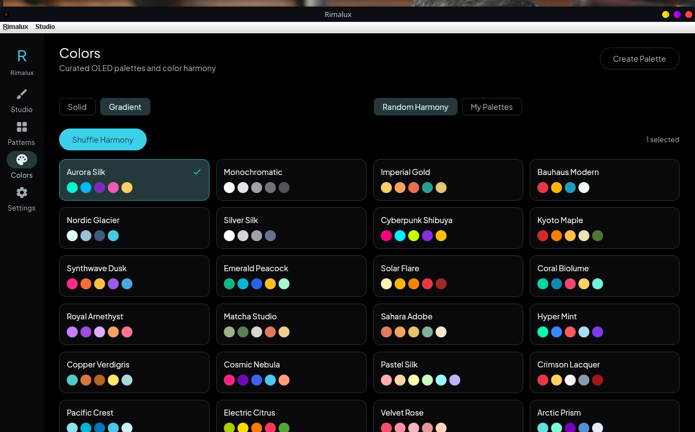
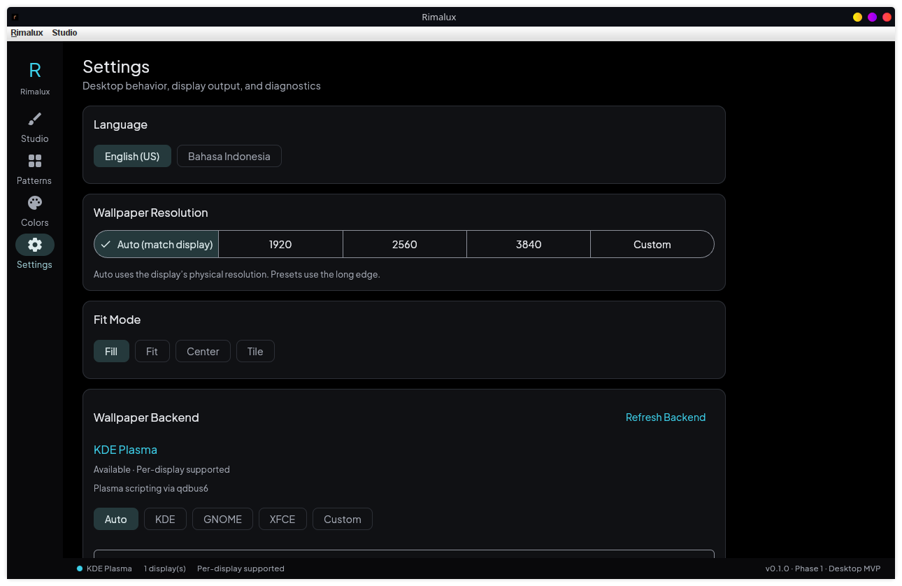

# Rimalux Desktop

Procedural OLED wallpaper studio for **Linux** and **Windows**, ported from the Android app
[`cptodix/rimalux`](https://github.com/cptodix/rimalux).

Rimalux generates mathematical vector wallpapers with an exact, user-selected `#000000`
True Black Ratio, 80 procedural patterns, 41 curated palettes, gradient/solid color fills,
normal and center-weighted layouts, per-monitor wallpapers, lossless PNG export, and
background auto-change.

> **Status:** Phase 0 + Phase 1 implemented and verified on KDE Plasma Wayland.
> The app is runnable on Linux. Auto-change, tray mode, and the Windows backend are scheduled for
> the next phases — see [`docs/ROADMAP.md`](docs/ROADMAP.md) and
> [`docs/VERIFICATION.md`](docs/VERIFICATION.md).

---

## Screenshots

| Studio | Patterns |
|---|---|
|  |  |

| Colors | Settings |
|---|---|
|  |  |

## What is implemented today

- Pure Kotlin wallpaper engine synced from the Android project.
- Compose Desktop native UI (Studio, Patterns, Colors, Settings).
- Live Skia-rendered previews with exact true-black measurement.
- 80 patterns, 41 palettes, custom palettes, true-black slider/range.
- Solid and gradient color fills.
- Normal and center-weighted pattern layouts.
- Monitor detection and per-monitor preview targets.
- KDE Plasma wallpaper apply (per-monitor via Plasma scripting) and GNOME global apply.
- Lossless PNG export to `~/Pictures/Rimalux`.
- English and Bahasa Indonesia localization.
- JSON settings persistence and wallpaper-set history.

## What comes next

- Phase 2: tray-resident auto-change, start at login, catch-up/dedupe, single instance.
- Phase 3: Windows wallpaper backend (`SystemParametersInfoW` + `IDesktopWallpaper`), MSI/EXE.
- Phase 4: release polish, diagnostics, optional systemd/Task Scheduler mode.

See [`docs/ROADMAP.md`](docs/ROADMAP.md) and [`docs/IMPLEMENTATION_PLAN.md`](docs/IMPLEMENTATION_PLAN.md).

---

## Quick start (Linux)

Requirements:

- JDK 17 or newer (JDK 17 is used for the Gradle toolchain).
- A desktop session: KDE Plasma, GNOME, XFCE, Cinnamon, MATE, or Budgie.
- Internet access on the first build to download Gradle dependencies.

```bash
cd /home/cptodix/WorkingFolder/Programming/rimalux-desktop
./gradlew :desktopApp:run
```

If you need to regenerate the shared engine/string/preview assets from the Android checkout:

```bash
./gradlew syncAll
```

Verified environment: openSUSE Tumbleweed, KDE Plasma 6.7.5 Wayland, JDK 17, 1920×1080 display.
Detailed run instructions and troubleshooting: [`docs/RUNNING.md`](docs/RUNNING.md).

## Build installers

```bash
# Linux (run on Linux). A full JDK with jmods is required for jlink/jpackage.
RIMALUX_PACKAGING_JDK=/path/to/jdk-21 ./gradlew :desktopApp:packageRpm
RIMALUX_PACKAGING_JDK=/path/to/jdk-21 ./gradlew :desktopApp:packageDeb

# Windows (must run on Windows)
.\gradlew.bat :desktopApp:packageMsi
.\gradlew.bat :desktopApp:packageExe
```

RPM packaging was verified on this machine with Temurin 21. See
[`docs/BUILD_AND_RELEASE.md`](docs/BUILD_AND_RELEASE.md).

## Repository layout

```text
rimalux-desktop/
├── core/                       # Pure Kotlin engine synced from the Android app
├── desktopApp/                 # Compose Desktop application
│   └── src/main/
│       ├── kotlin/             # UI, renderer, platform backends, persistence
│       └── composeResources/   # Strings, previews, fonts, icons
├── docs/                       # Architecture, porting, rules, runbooks
├── AGENTS.md                   # Agent handover rules
└── gradle/                     # Version catalog and wrapper
```

## Documentation

| Document | Purpose |
|---|---|
| [`AGENTS.md`](AGENTS.md) | Rules and handover guide for AI agents/contributors |
| [`docs/CONTEXT.md`](docs/CONTEXT.md) | Product context, decisions, environment |
| [`docs/ARCHITECTURE.md`](docs/ARCHITECTURE.md) | Module and runtime architecture |
| [`docs/PORTING_STRATEGY.md`](docs/PORTING_STRATEGY.md) | What is reused vs rebuilt from Android |
| [`docs/ENGINE_SYNC.md`](docs/ENGINE_SYNC.md) | Engine sync contract and invariants |
| [`docs/KNOWLEDGE_BASE.md`](docs/KNOWLEDGE_BASE.md) | Engine math, terminology, resource conventions |
| [`docs/DESKTOP_UX.md`](docs/DESKTOP_UX.md) | Desktop UI specification |
| [`docs/AUTO_CHANGE.md`](docs/AUTO_CHANGE.md) | Auto-change design (Phase 2) |
| [`docs/LINUX_WALLPAPER_BACKENDS.md`](docs/LINUX_WALLPAPER_BACKENDS.md) | Linux DE support matrix |
| [`docs/WINDOWS_WALLPAPER_BACKENDS.md`](docs/WINDOWS_WALLPAPER_BACKENDS.md) | Windows APIs and limitations |
| [`docs/BUILD_AND_RELEASE.md`](docs/BUILD_AND_RELEASE.md) | Build, package, CI, release |
| [`docs/TESTING.md`](docs/TESTING.md) | Test suites and manual verification |
| [`docs/RUNNING.md`](docs/RUNNING.md) | How to run and troubleshoot |
| [`docs/ROADMAP.md`](docs/ROADMAP.md) | Phase status |
| [`docs/IMPLEMENTATION_PLAN.md`](docs/IMPLEMENTATION_PLAN.md) | Detailed agentic checklist |
| [`docs/VERIFICATION.md`](docs/VERIFICATION.md) | Phase 0/1 verification log |
| [`docs/DECISIONS.md`](docs/DECISIONS.md) | Architecture decision records |

## License

GPL-3.0. See [`LICENSE`](LICENSE). The engine and design language originate from the
Android Rimalux project by Cptodix Studio.
